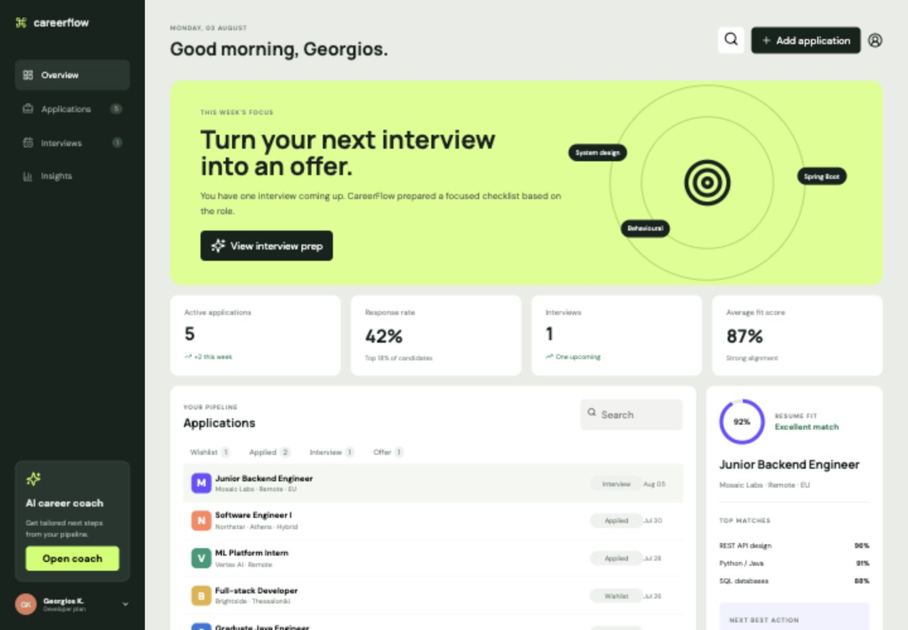

# CareerFlow

CareerFlow is a polished job-search command center for tracking applications, prioritizing next steps and measuring resume-to-role alignment. It is intentionally built as a portfolio project around technologies commonly requested in modern software roles.

[Open the live interactive demo](https://gkaramou.github.io/careerflow-ai/)



## Why this project matters

- A complete React + TypeScript product interface, not an API-only demo
- FastAPI backend with typed schemas and OpenAPI documentation
- PostgreSQL persistence through async SQLAlchemy
- JWT authentication and Argon2 password hashing
- User-scoped application data and fit analysis
- Pytest coverage, Docker Compose and GitHub Actions CI
- Responsive dashboard with a functional add-application workflow

## Run the interface

```bash
npm ci
npm run dev
```

Open `http://localhost:5173`.

The GitHub Pages deployment is a recruiter-friendly frontend demo with seeded
sample data and a working add-application flow. Run the full stack locally to
start the API and PostgreSQL services as well.

## Run the full stack

```bash
docker compose up --build
```

- Web UI: `http://localhost:8080`
- API docs: `http://localhost:8000/docs`
- Health check: `http://localhost:8000/health`

## Backend tests

```bash
cd backend
python -m venv .venv
source .venv/bin/activate
pip install -e '.[test]'
pytest
```

## Architecture

```text
React + TypeScript UI
        |
        | REST / JWT
        v
FastAPI application
        |
        | async SQLAlchemy
        v
PostgreSQL
```

## Production roadmap

- Add Alembic migrations and refresh-token rotation
- Connect the UI to the authenticated API
- Replace lexical fit scoring with an embedding service
- Add scheduled reminders and calendar integration
- Deploy frontend and API separately with managed PostgreSQL

## Security

Development defaults are included only for local setup. Production secrets must be injected through the deployment platform. Passwords are Argon2-hashed and application queries are scoped to the authenticated user.

## License

MIT
